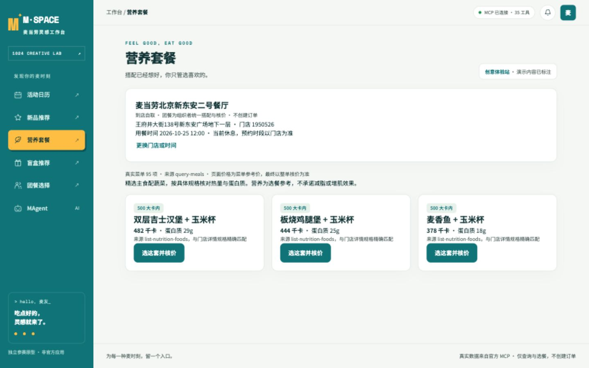

# M·SPACE — 麦当劳灵感工作台

六个独立入口，为不同的麦当劳消费场景提供活动发现、选餐和信息查询。基于麦当劳中国官方 MCP，个人参赛作品，非官方应用。

目标用户：希望快速了解活动、新品、营养组合的个人消费者，以及统一安排团建用餐的组织者。



## 六个场景

| 模块 | 使用流程 | 真实 MCP 能力 |
| --- | --- | --- |
| 活动日历 | 月历 → 按日活动 → 详情 / 站内提醒 | campaign-calendar、now-time-info |
| 新品推荐 | 选择门店和时间 → 门店上新列表 → 默认规格 → 核价 | query-nearby-stores、query-meals、query-meal-detail、calculate-price |
| 营养套餐 | 选择门店 → 点击精选组合 → 整单核价 | 门店菜单 / 详情 + list-nutrition-foods + calculate-price |
| 盲盒推荐 | 输入预算或人数 → 转盘搭配 → 核价 → 换一套 | 真实可售菜单、默认规格、整单核价 |
| 团餐选择 | 人数或总预算 → 每人主食搭配 → 统一清单核价 | 同上；组织者统一自取，无分账和邀请 |
| MAgent | 简短问题 / 选择工具 → 补全参数 → 真实结果 | 实时 35 工具展示，28 个只读工具可选，7 个写操作拦截 |

桌面和手机均为左目录、右内容；四种宽度 375 / 390 / 430 / 1440 的六个页面均经浏览器检查，无横向溢出。

## 启动

需要 Node 22.x 和 pnpm 10；项目提供 `app/mise.toml` 及锁文件。

```sh
cd app
pnpm install --frozen-lockfile
pnpm mcp:server
# 另一个终端，同一 app 目录
pnpm dev
```

访问 http://127.0.0.1:10241 。未配置凭证时为演示模式，可体验六个入口。

真实模式：从 [官方 MCP 平台](https://open.mcd.cn/mcp) 申请 Token，在本机执行：

```sh
cp server/.env.example server/.env
chmod 600 server/.env
# 在编辑器中填写 MCD_MCP_TOKEN，再重启 pnpm mcp:server
```

凭证仅放在服务端。前端调用本机适配器，不应把 `.env` 上传到 GitHub。

MAgent 默认使用直连工具模式。若需要模型决定调用工具，在同一文件配置 `M_AGENT_BASE_URL`、`M_AGENT_API_KEY`、`M_AGENT_MODEL`。支持兼容 Chat Completions 的接口，每轮最多五次只读工具调用。配置后聊天和所调用的工具结果会发给选定的模型服务。**本次未配置外部模型：已验证本地协议和循环测试，未验证真实外部模型回答。**

## 体验示例

1. 新品页点击「体验北京王府井示例」，明确选择一家门店；示例使用公开门店与今日午餐时间，不代表用户位置。若时段已过，请改为门店可预约时间。
2. 营养页选择「板烧鸡腿堡 + 玉米杯」，查看官方营养表匹配结果及整单报价。
3. 团餐页保留 6 人、清空总预算，按人均 30 元推荐并核价；点击「换一套」重新搭配。
4. MAgent 输入「附近门店」，补充取餐方式、城市、地点及查询方式后查询。

## 验证

```sh
cd app
pnpm verify  # 59 项领域 + 42 项服务端测试、类型检查、构建

# 可选浏览器复现；先启动 dev 和 adapter
pnpm exec playwright install chromium
pnpm exec node scripts/e2e-asserts.mjs
pnpm exec node scripts/live-e2e.mjs  # 需要真实 MCP 配置
pnpm exec node scripts/shots.mjs
```

本次通过 CUA 实际浏览器完成关键交互和四视口检查；重写的便携浏览器脚本通过语法检查，未单独执行，也未在其他操作系统验证。真实结果与测试边界见 [验收记录](docs/ACCEPTANCE.md)。

## 范围与限制

- 无真实下单、支付、领券、抽奖或地址创建。7 个写工具在服务端默认拦截。
- 营养为精选组合，按具体规格精确匹配；不推断缺失值，不承诺减脂、增肌或个体健康效果。
- 新品以所选门店菜单「上新」标签为准。菜单价用于候选筛选，整单实际报价超过预算时拒绝展示为成功。
- 当前选餐页支持到店自取与预约时间；团餐指组织者统一搭配，不等于官方企业团餐下单。
- 活动日期组仅表示收录日期，不推断起止。提醒保存在当前浏览器，不发送外部通知。
- 账号、优惠券、订单等只读工具已注册并可填参，但未逐一访问个人数据验证。

参赛文件：[接入说明](MCP_INTEGRATION.md)、[声明](CONTEST_DECLARATION.md)、[WorkBuddy 开发摘录](workbuddy.md)、[报名文案与清单](docs/CONTEST_SUBMISSION.md)。代码发布与官方报名分别处理；本仓库不代表报名成功。
